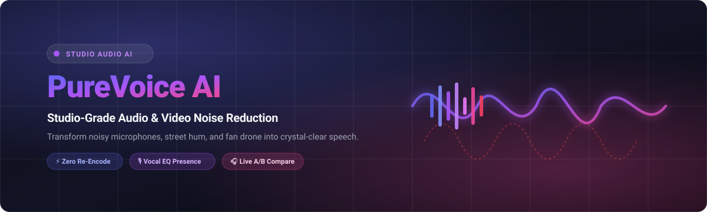
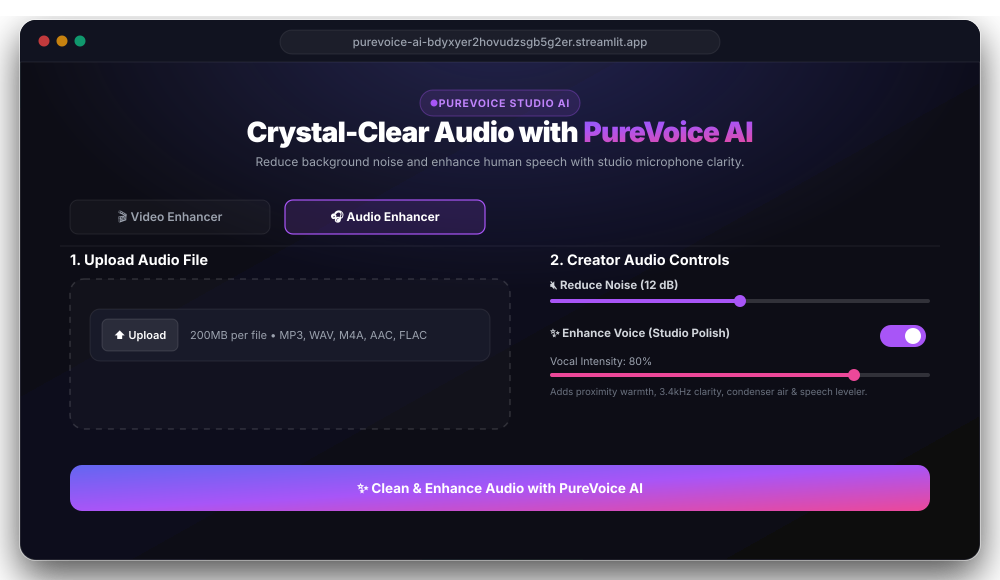

<div align="center">

  

  <br/><br/>

  [](LICENSE)
  [](https://purevoice-ai-bdyxyer2hovudzsgb5g2er.streamlit.app/)
  [](https://github.com/rajvisual/purevoice-ai/releases)

  <br/><br/>

  <a href="https://purevoice-ai-bdyxyer2hovudzsgb5g2er.streamlit.app/" target="_blank">
    
  </a>

  <br/><br/>

  <h3>Studio-grade speech enhancement &amp; background noise reduction for Audio and Video.</h3>
  <p>Eliminate air conditioning hum, fan drone, keyboard clatter, wind rumble, and street noise with one click.</p>

  <br/>

  

</div>

---

## 🌐 Launch PureVoice AI (Online & Free)

Use the tool directly in your browser without installing anything:

### 👉 [https://purevoice-ai-bdyxyer2hovudzsgb5g2er.streamlit.app/](https://purevoice-ai-bdyxyer2hovudzsgb5g2er.streamlit.app/)

---

## ✨ Features

* **🤖 Smart AI Auto-Detect (Zero-Guesswork)**:
  Instantly scans acoustic dynamic range and ambient noise floor in under 0.05s to automatically calculate and apply the ideal noise reduction (dB) and vocal polish (%) without any creator guesswork.
* **🔇 Reduce Noise (AI Deep Neural Network + Studio DSP)**:
  Wipes away background air conditioning hum, PC fans, street traffic, and wind rumble from any audio or video file.
* **✨ Enhance Voice (Studio Microphone Polish)**:
  Instagram-style vocal enhancement that boosts 160Hz proximity warmth, brings 3.4kHz speech clarity forward, adds silky condenser air sheen, and levels words smoothly.
* **⚡ Lossless Video Remuxing**:
  The video stream is never re-compressed. PureVoice replaces only the audio track, preserving **100% 4K/60FPS video quality** in seconds.
* **🎛️ 4 Tuned Presets**:
  * **✨ PureVoice Creator**: Balanced vocal clarity + proximity warmth + 65Hz low-cut.
  * **🎙️ Studio Podcast**: High noise reduction for noisy streets, cafés, and echoey rooms.
  * **🍃 Wind & Mic Handling**: Aggressive 95Hz high-pass filter targeting wind rumble and mic vibrations.
  * **🎚️ Subtle Cleanup**: Soft room cleanup, keeping natural room warmth intact.
* **⬇️ One-Click Studio Export**:
  Direct high-quality download of cleaned MP4 video and MP3 audio.

---

## 🛠️ The PureVoice Audio Pipeline

```
[Raw Audio / Video]
        │
        ▼
0. Smart Acoustic Scan     ──► Scans dynamic range & ambient noise in < 0.05s
        │                      to auto-calculate optimal dB cut and vocal polish %
        ▼
1. 65 Hz High-Pass Filter  ──► Eliminates wind rumble and desk thumps without cutting chest voice
        │
        ▼
2. AI / Spectral Denoising ──► Wipes away continuous noise floor (AC drone, fans, street hiss)
        │                      with smooth gain transition to eliminate musical chirping
        ▼
3. Studio Vocal Enhancer   ──► 160Hz proximity warmth + 380Hz boxiness notch + 3.4kHz vocal
        │                      presence formants + 9.5kHz condenser air sheen
        ▼
4. Dynamic Speech Leveler  ──► Normalizes quiet speech while keeping pauses completely silent
        │
        ▼
5. Lossless Remux (-c:v copy)► Video stream copied 1:1 without transcoding.
                               Instant export, 100% 4K/60FPS video quality preserved!
```

---

## 🏷️ Repository Tags & Topics

```text
audio-denoiser, speech-enhancement, noise-reduction, voice-filter,
ffmpeg, podcast-tools, sound-restoration, video-audio-cleanup,
streamlit, creator-tools, python, audio-processing
```

---

## 📄 License

Distributed under the **MIT License**. See [`LICENSE`](LICENSE) for details.
